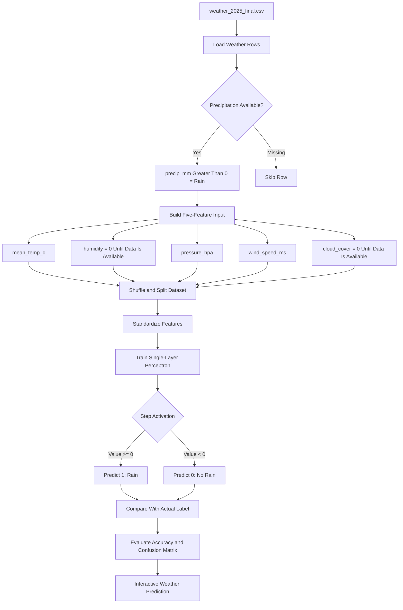

# 🌦️ Weather Rain Prediction — Single-Layer Perceptron

> A from-scratch implementation of a single-layer perceptron that predicts whether it rains using weather measurements.

[](LICENSE)
[](https://www.python.org/)

**Repository:** [shivangichaudhary-cse/RE-SINGLE-LAYER-PERCEPTRON](https://github.com/shivangichaudhary-cse/RE-SINGLE-LAYER-PERCEPTRON)

---

## 📌 Overview

This educational project trains a binary classifier using a **single-layer perceptron** implemented entirely in plain Python—without NumPy, scikit-learn, TensorFlow, or PyTorch.

Given five weather features, the model predicts:

- `1` — Rain
- `0` — No rain

The project currently uses `weather_2025_final.csv`, a 2025 sample dataset. The data is suitable for learning and experimentation, but it is **not an official weather source and is not reliable for real forecasts**.

> ⚠️ **This is an experimental educational model, not a meteorological forecasting system.**

---

## ✨ Features

- Pure Python implementation
- Custom `StandardScaler`
- Deterministic 75/25 train/test split with seed `42`
- Perceptron weight and bias updates
- Epoch-by-epoch training output
- Accuracy and confusion-matrix reporting
- Interactive prediction interface
- Input validation for malformed datasets
- Placeholder support for unavailable humidity and cloud-cover data

---

## 🧠 How It Works



### Perceptron equation

```text
z = (w₁x₁ + w₂x₂ + w₃x₃ + w₄x₄ + w₅x₅) + b

prediction = 1, if z >= 0
prediction = 0, if z < 0
```

| Symbol | Meaning |
|---|---|
| `x` | Scaled weather feature |
| `w` | Learned weight |
| `b` | Learned bias |
| `z` | Weighted sum |

### Learning rule

```text
weight = weight + learning_rate × error × input
bias   = bias   + learning_rate × error

error = actual_label - predicted_label
```

---

## 📊 Dataset

The project currently uses [`weather_2025_final.csv`](weather_2025_final.csv), a 2025 sample containing 365 daily records.

> The CSV is based on sample data rather than an official meteorological dataset. It may contain approximations or simulated information.

| Feature | CSV column | Status | Unit |
|---|---|---|---|
| Temperature | `mean_temp_c` | Available | °C |
| Humidity | `humidity` | Placeholder | % |
| Pressure | `pressure_hpa` | Available | hPa |
| Wind speed | `wind_speed_ms` | Available | m/s |
| Cloud cover | `cloud_cover` | Placeholder | % |
| Target | Derived from `precip_mm` | `precip_mm > 0` → `1`; `precip_mm = 0` → `0` | — |

Humidity and cloud cover are still included as model features. Because this dataset does not currently provide them, both use `0.0` while loading:

```python
humidity = float(humidity_text) if humidity_text else 0.0
cloud_cover = float(cloud_text) if cloud_text else 0.0
```

When real humidity or cloud-cover data becomes available, add a matching column to the CSV and replace the placeholder values.

**Dataset preview:**

```csv
date,mean_temp_c,min_temp_c,max_temp_c,precip_mm,wind_dir_deg,wind_speed_ms,pressure_hpa
2025-01-01,7.1,4.6,11.4,0.0,320,9.8,1015.2
2025-01-02,7.7,2.4,13.6,0.0,355,6.0,1015.3
2025-01-03,5.6,4.2,6.8,1.6,21,7.8,1014.8
```

Rows with missing precipitation values are skipped because they cannot produce a reliable rain label.

---

## 🗂️ Project Structure

```text
RE-SINGLE-LAYER-PERCEPTRON/
├── rain_perceptron.py.          # Training, evaluation, and prediction
├── weather_2025_final.csv       # 2025 sample weather dataset
├── Weather.csv                  # Small original demonstration dataset
├── 47662.csv.gz                 # Original compressed source download
├── README.md                    # Project documentation
└── LICENSE                      # MIT license
```

> The source currently uses a trailing dot in `rain_perceptron.py.`; this is not the conventional `.py` extension.

---

## 🚀 Getting Started

### Prerequisites

- Python 3
- No third-party packages

Check Python:

```bash
python --version
```

### Clone the repository

```bash
git clone https://github.com/shivangichaudhary-cse/RE-SINGLE-LAYER-PERCEPTRON.git
cd RE-SINGLE-LAYER-PERCEPTRON
```

### Run the program

```bash
python "rain_perceptron.py."
```

The program automatically loads:

```text
weather_2025_final.csv
```

---

## 💻 Example Session

```text
RAIN PREDICTION USING PERCEPTRON
========================================

--- TRAINING ---
Epoch 1: 47 incorrect predictions
Epoch 2: 28 incorrect predictions
...

--- MODEL EVALUATION ---
Accuracy: 72.53%

Confusion Matrix:
True Positives:  24
True Negatives:  42
False Positives: 12
False Negatives: 13

--- ENTER WEATHER MEASUREMENTS ---
Temperature (C): 22
Humidity (%) [enter 0 if unavailable]: 0
Pressure (hPa): 1012
Wind speed (m/s): 8
Cloud cover (%) [enter 0 if unavailable]: 0

--- PREDICTION ---
The model predicts RAIN.
(Experimental model output, not a reliable weather forecast.)
```

The values above are illustrative. Training results depend on the random split and the data available in the CSV.

---

## 🧩 Code Walkthrough

| Component | Responsibility |
|---|---|
| `load_dataset()` | Reads the sample CSV and derives the rain label |
| `train_test_split()` | Randomly divides data using seed `42` |
| `StandardScaler` | Standardizes each of the five model features |
| `SingleLayerPerceptron` | Stores weights/bias and implements training |
| `net_input()` | Calculates the weighted sum |
| `activation()` | Applies the step activation function |
| `fit()` | Trains for up to 100 epochs |
| `evaluate_model()` | Calculates accuracy and confusion-matrix values |
| `predict_weather()` | Collects input and prints a prediction |

---

## 📈 Model Limitations

- Uses a **linear decision boundary**.
- Humidity and cloud cover are placeholder zero values for now.
- Trained on sample 2025 data rather than official or verified observations.
- The perceptron may be sensitive to the single random train/test split.
- Missing or incomplete precipitation values are skipped.
- No official geographic station information is modeled.
- Learned weights are not saved between runs.

---

## 🔧 Possible Improvements

- Add real humidity and cloud-cover columns when available
- Rename the source file to `rain_perceptron.py`
- Replace the placeholder values with missing-value handling or imputation
- Add command-line arguments for dataset and hyperparameters
- Save and load trained weights
- Add stratified train/test splitting
- Report precision, recall, F1 score, and ROC-AUC
- Add automated unit tests
- Add plots for training error and the decision boundary
- Validate the model using official weather observations

---

## 🧪 Testing

The project does not currently include an automated test suite.

A basic syntax check is:

```bash
python -m compileall .
```

For functional testing, run the program and verify that:

- `weather_2025_final.csv` loads successfully
- Rows with missing precipitation are skipped
- The dataset creates valid `0` and `1` labels
- Training finishes or converges
- Accuracy is printed
- Confusion-matrix values sum to the test-set size
- Custom input produces a valid prediction

---

## 🤝 Contributing

Contributions are welcome.

1. Fork the repository
2. Create a feature branch

   ```bash
   git checkout -b feature/improvement
   ```

3. Commit your changes

   ```bash
   git commit -m "Improve weather perceptron"
   ```

4. Push your branch

   ```bash
   git push origin feature/improvement
   ```

5. Open a pull request

---

## 📄 License

This project is licensed under the [MIT License](LICENSE).

Copyright © 2026 Shivangi Chaudhary

---

## 👩‍💻 Author

**Shivangi Chaudhary**

- GitHub: [@shivangichaudhary-cse](https://github.com/shivangichaudhary-cse)
