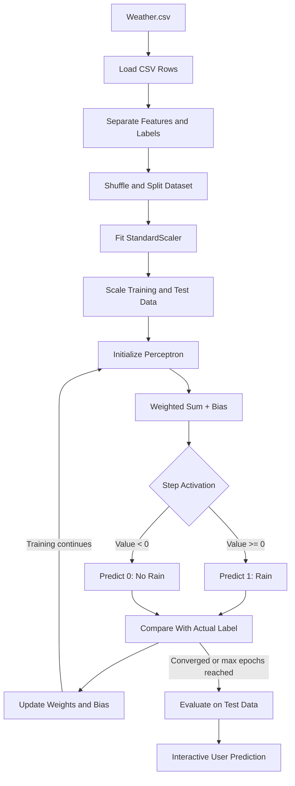

# 🌦️ Weather Rain Prediction — Single-Layer Perceptron

> A from-scratch implementation of a single-layer perceptron that predicts whether it will rain from basic weather measurements.

[](LICENSE)
[](https://www.python.org/)

**Repository:** [shivangichaudhary-cse/RE-SINGLE-LAYER-PERCEPTRON](https://github.com/shivangichaudhary-cse/RE-SINGLE-LAYER-PERCEPTRON)

---

## 📌 Overview

This project trains a binary classifier using a **single-layer perceptron** implemented in plain Python—without NumPy, scikit-learn, TensorFlow, or PyTorch.

Given five weather features, the model predicts:

- `1` — Rain
- `0` — No rain

The program loads a small CSV dataset, scales the features, trains the model, reports test accuracy and a confusion matrix, and then accepts custom weather measurements through an interactive prompt.

> ⚠️ **This is an educational project**, not a reliable meteorological forecasting system.

---

## ✨ Features

- Pure Python implementation
- Custom `StandardScaler`
- Deterministic train/test split with a fixed random seed
- Perceptron weight and bias updates
- Epoch-by-epoch training output
- Accuracy and confusion matrix reporting
- Interactive prediction interface
- Input validation for malformed datasets

---

## 🧠 How It Works



### Perceptron equation

```text
z = (w₁x₁ + w₂x₂ + w₃x₃ + w₄x₄ + w₅x₅) + b

prediction = 1, if z >= 0
prediction = 0, if z < 0
```

| Symbol | Meaning |
|---|---|
| `x` | Scaled weather feature |
| `w` | Learned weight |
| `b` | Learned bias |
| `z` | Weighted sum |

### Learning rule

```text
weight = weight + learning_rate × error × input
bias   = bias   + learning_rate × error
```

Where:

```text
error = actual_label - predicted_label
```

---

## 📊 Dataset

The included [`Weather.csv`](Weather.csv) contains 20 records.

| Feature | Column | Unit / scale |
|---|---|---|
| Temperature | `temperature` | °C |
| Humidity | `humidity` | % |
| Pressure | `pressure` | hPa |
| Wind speed | `wind_speed` | km/h |
| Cloud cover | `cloud_cover` | % |
| Target | `rain` | `0` = no rain, `1` = rain |

Each row is intentionally separated into an easy no-rain cluster and an easy rain cluster, making the perceptron suitable for demonstrating binary classification.

**Dataset preview:**

```csv
temperature,humidity,pressure,wind_speed,cloud_cover,rain
28,42,1016,7,15,0
29,88,1001,24,95,1
```

---

## 🗂️ Project Structure

```text
RE-SINGLE-LAYER-PERCEPTRON/
├── rain_perceptron.py.  # Training, evaluation, and interactive prediction
├── Weather.csv          # Weather measurements and rain labels
├── README.md            # Project documentation
└── LICENSE              # MIT license
```

> The Python source currently has a trailing dot in its filename: `rain_perceptron.py.` (a Python script normally ends in `.py`).

---

## 🚀 Getting Started

### Prerequisites

- Python 3
- No third-party packages

Check Python:

```bash
python --version
```

### Clone the repository

```bash
git clone https://github.com/shivangichaudhary-cse/RE-SINGLE-LAYER-PERCEPTRON.git
cd RE-SINGLE-LAYER-PERCEPTRON
```

### Run the program

Because the filename contains a trailing dot, run it exactly as:

```bash
python "rain_perceptron.py."
```

> **Note:** The program currently loads `weather.csv`, while the repository file is named `Weather.csv`. On Linux and other case-sensitive systems, rename the file or change the filename in `main()` to `"Weather.csv"`.

```bash
mv Weather.csv weather.csv
python "rain_perceptron.py."
```

On Windows, use:

```powershell
Rename-Item Weather.csv weather.csv
python rain_perceptron.py.
```

---

## 💻 Example Session

```text
RAIN PREDICTION USING PERCEPTRON
========================================

--- TRAINING ---
Epoch 1: 3 incorrect predictions
Epoch 2: 0 incorrect predictions
Training converged!

--- MODEL EVALUATION ---
Accuracy: 100.00%

Confusion Matrix:
True Positives:  2
True Negatives:  3
False Positives: 0
False Negatives: 0

Learned weights: [0.12, 0.34, ...]
Learned bias: 0.02

--- ENTER WEATHER MEASUREMENTS ---
Temperature (C): 27
Humidity (%): 89
Pressure (hPa): 1002
Wind speed (km/h): 22
Cloud cover (%): 93

--- PREDICTION ---
The model predicts RAIN.
(Experimental model output, not a reliable weather forecast.)
```

The example output is illustrative; learned parameters and metrics may vary if the implementation or data changes.

---

## 🧩 Code Walkthrough

| Component | Responsibility |
|---|---|
| `load_dataset()` | Reads CSV features and binary labels |
| `train_test_split()` | Randomly divides data while using seed `42` |
| `StandardScaler` | Fits feature means and standard deviations; transforms data |
| `SingleLayerPerceptron` | Stores weights/bias and implements training |
| `net_input()` | Calculates the weighted sum |
| `activation()` | Applies a step activation function |
| `fit()` | Trains the perceptron over up to 100 epochs |
| `evaluate_model()` | Calculates accuracy and confusion-matrix values |
| `predict_weather()` | Collects input and prints the final prediction |

---

## 📈 Model Limitations

- Uses a **linear decision boundary**, so it cannot learn every dataset pattern.
- Trained on only 20 records.
- Uses a small, manually designed dataset that may not represent real weather.
- The random 75/25 split may leave few examples for testing.
- Scaling currently uses the full training split, but it is not repeatedly cross-validated.
- No persistence: learned weights are discarded when the program exits.
- No model metrics are printed in machine-readable formats.

---

## 🔧 Possible Improvements

- Rename the source file to `rain_perceptron.py`
- Standardize the dataset filename as `Weather.csv`
- Add command-line arguments for learning rate, epochs, and test ratio
- Save and load trained weights
- Add a larger and more realistic weather dataset
- Provide precision, recall, F1 score, and ROC-AUC
- Use stratified train/test splitting
- Split scaling only from training data in a clear evaluation pipeline
- Add unit tests for loading, scaling, training, and prediction
- Add a plotting mode for decision boundaries and training error history

---

## 🧪 Testing

The project does not currently include an automated test suite.

A basic smoke test is:

```bash
python -m compileall .
```

For functional testing, run the program and verify that:

- The CSV loads successfully
- Training finishes or converges
- Accuracy is printed
- Confusion-matrix values sum to the test-set size
- Custom input produces a valid `0` or `1` prediction

---

## 🤝 Contributing

Contributions are welcome.

1. Fork the repository
2. Create a feature branch
   ```bash
   git checkout -b feature/improvement
   ```
3. Commit your changes
   ```bash
   git commit -m "Improve perceptron implementation"
   ```
4. Push your branch
   ```bash
   git push origin feature/improvement
   ```
5. Open a pull request

Before contributing, keep educational readability and minimal dependencies in mind.

---

## 📄 License

This project is licensed under the [MIT License](LICENSE).

Copyright © 2026 Shivangi Chaudhary

---

## 👩‍💻 Author

**Shivangi Chaudhary**

- GitHub: [@shivangichaudhary-cse](https://github.com/shivangichaudhary-cse)
